## A. Identitas dan Capaian Praktikum

| | |
|---|---|
| **Nama** | Jumari |
| **NIM** | 312510077 |
| **Kelas** | I252A |
| **Mata Kuliah** | Pemrograman Web |
| **Nomor Modul** | 7 |
| **Topik** | Pemrograman server-side dengan PHP |
| **Cakupan** | Sintaks PHP, variabel, function, form processing, dan pengolahan data |
| **Perangkat** | Laptop/PC, web browser, Visual Studio Code, PHP, dan server lokal Laragon |

## B. Tujuan Praktikum

1. Memahami perbedaan pemrosesan client-side dan server-side.
2. Mengenali sintaks PHP dan menjalankan file PHP melalui server lokal.
3. Menggunakan variabel, tipe data, operator, percabangan, perulangan, dan function.
4. Menerima dan memproses data dari form HTML menggunakan metode GET dan POST.
5. Melakukan validasi dan sanitasi input dasar sebelum data ditampilkan atau diproses.
6. Membangun aplikasi sederhana yang menerima, memproses, dan menampilkan data pengguna.

## C. Latihan

Struktur Folder:

```
C:\laragon\www\Lab7_php\
|
|-- index.php
|-- miniproject.php
```

Cara menjalankan server lokal:

- Menggunakan Laragon yang telah memiliki Apache dan PHP
- Mengatur Path sehingga terhubung dengan VSCODE dan dapat menulis syntax via vscode
- Klik kanan pada Laragon > Tools > Path > Add Laragon to Path

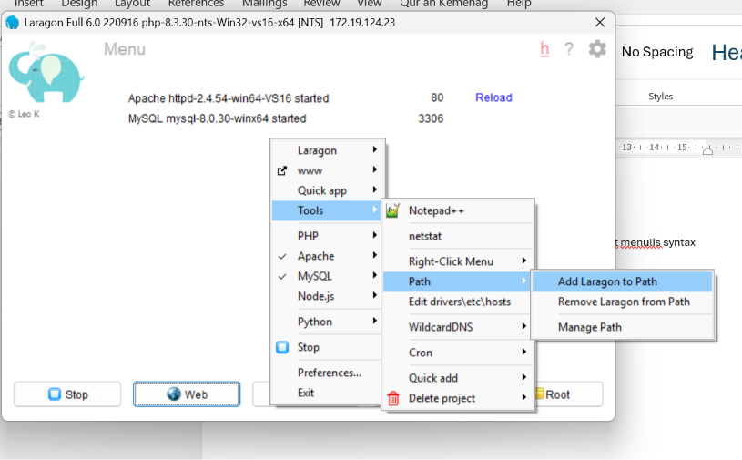

- Cek di vscode untuk validasi
- Ketik `php -v` pada terminal

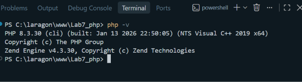

- Dengan output menghasilkan versi php, path telah tercipta dan dapat digunakan.

### 1. Menjalankan php

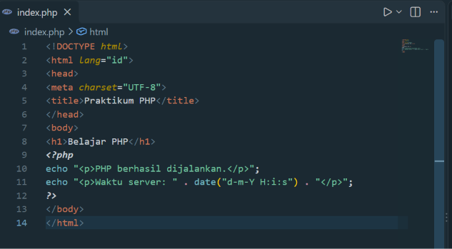

Output:

Gunakan <http://localhost/Lab7_php/> di internet explorer untuk menghasilkan output.

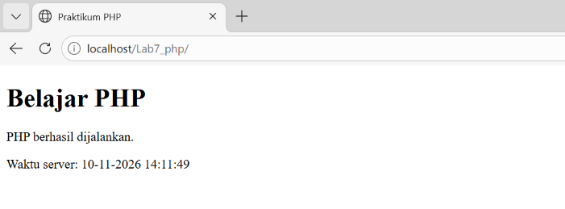

### 2. Variabel, operator, dan percabangan

Menggunakan logika if untuk menghasilkan predikat dengan perhitungan (tugas * 30%) + (uts * 30%) + (uas * 40%). Untuk hasil, rata-rata diatas 85 bernilai A, diatas 75 bernilai B, diatas 60 bernilai C, dibawah 60 bernilai D.

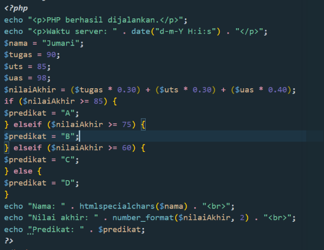

Output:

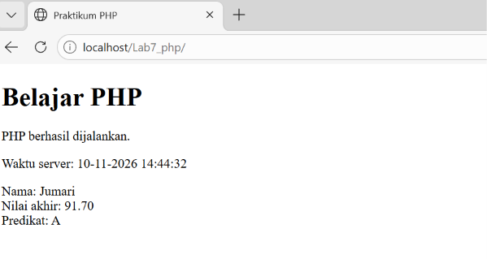

### 3. Perulangan dan Array

Menggunakan echo untuk menampilkan output. `</ol>` untuk ordered list.

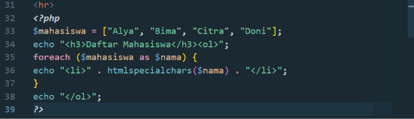

Output:

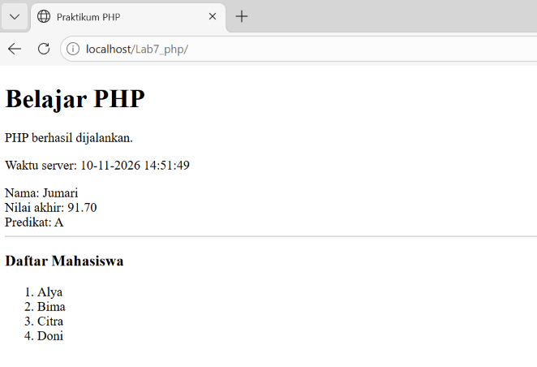

### 4. Membuat Function

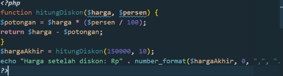

Output:

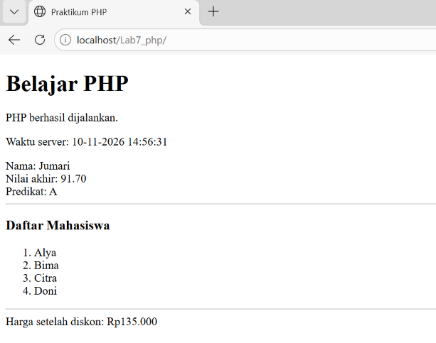

### 5. Memproses Form dengan Get

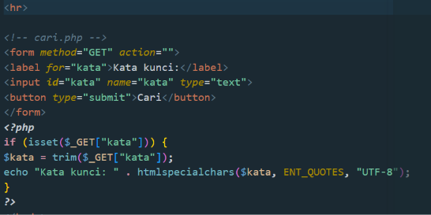

Output: Setelah mencari kata kunci "123". Catatan khusus: tidak boleh mengirim password menggunakan GET, karena akan muncul di halaman beranda.

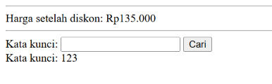

### 6. Pemproses form dengan POST

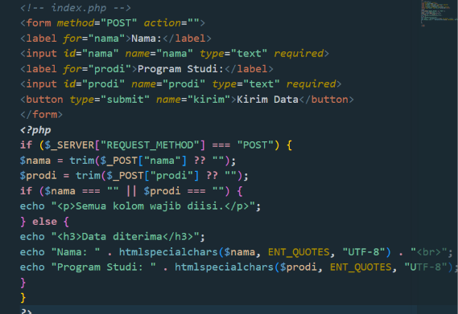

Output: Bila tidak mengisi form nama dan program studi

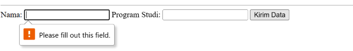

Output: Bila memasukkan tanda kutip

Tetap bisa diterima karena tipe data text. Menerima huruf, simbol, dan angka

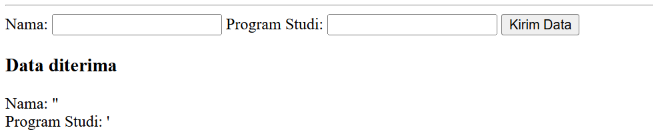

### 7. Pengolahan Data Sederhana

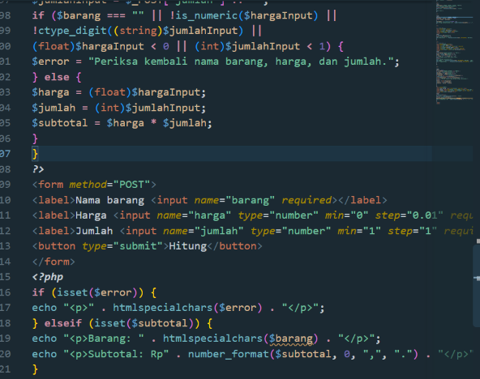

Output: kolom jumlah barang diisi desimal dan harga diisi bilangan bulat.

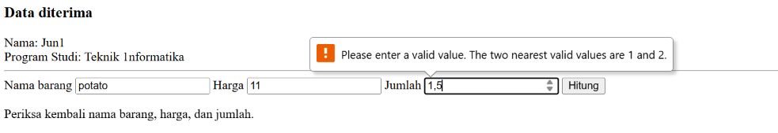

Output: Nama diisi, harga desimal dan jumlah bilangan bulat.

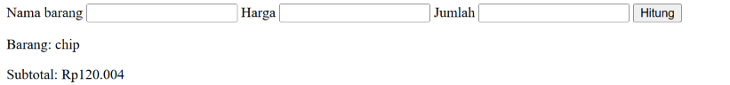

## Mini Project

Buat aplikasi sederhana yang menerima data mahasiswa dan menampilkan ringkasan data setelah dikirim.

- Form memuat nama, NIM, program studi, semester, dan email.
- Gunakan metode POST untuk mengirim data.
- Lakukan validasi server-side: kolom wajib diisi, semester berupa bilangan bulat dalam rentang yang ditentukan, dan email memiliki format valid.
- Tampilkan kembali data dengan `htmlspecialchars()`.
- Pisahkan bagian pemrosesan data dari tampilan HTML jika memungkinkan.

Struktur Folder:

```
C:\laragon\www\Lab7_php\
|
|-- index.php
|-- miniproject.php
```

### 1. Penjelasan Potongan Kode Mini Project

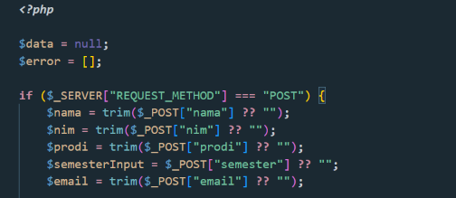

- `$data` dan `$error` berfungsi menyiapkan variabel penampung di tingkat teratas script.
- `trim` pada nama berfungsi menghilangkan spasi diawal dan diakhir input teks

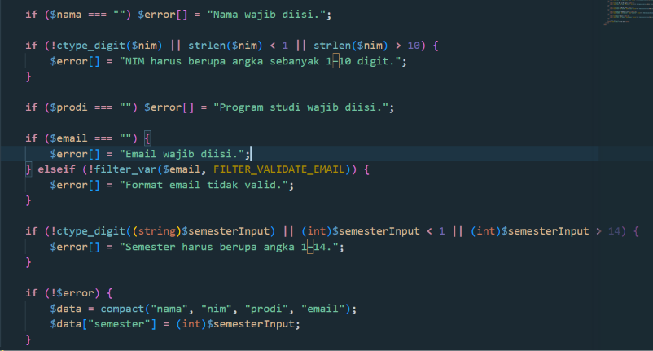

- `!ctype_digit` memastikan string nim murni berisi angka 0-9.
- `strlen` menghitung total jumlah digit angka
- `filter_validate` untuk memverifikasi apakah syntax email memiliki @
- int input < 1 || > 14 berfungsi memberikan peraturan nim hanya boleh ditulis pada banyak angka 1 sampai 14.
- `if(!$error)` untuk membuat array asosiatif secara otomatis berdasarkan nama variabel yang sudah ada.

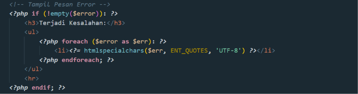

- `!empty` untuk memeriksa apakah array ada isinya
- `foreach` untuk mengulang dan mengeluarkan isi array satu persatu
- `htmlspecialchars` Menutup celah keamanan Cross-Site Scripting (XSS) dengan mengubah karakter khusus HTML (seperti < dan >) menjadi karakter entity aman

Output: Bila tidak memenuhi peraturan.

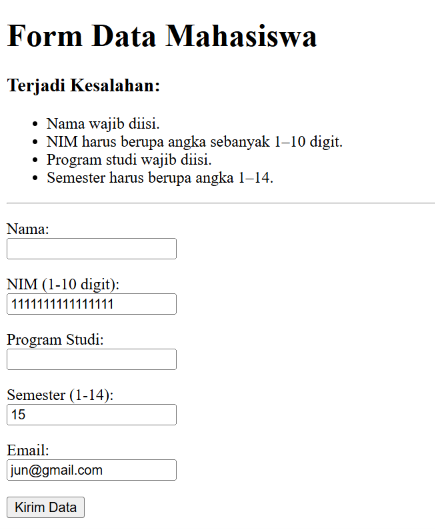

Output: Bila sesuai

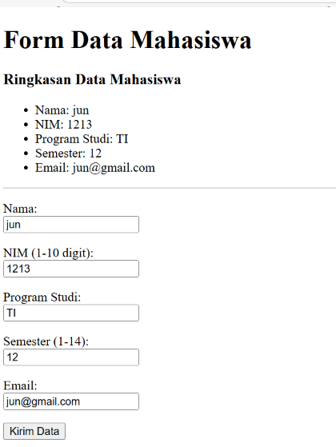

## D. Pertanyaan Evaluasi

### 1. Perbedaan Pemrosesan Client-Side dan Server-Side

- **Client-Side Processing:** Proses dilakukan langsung di perangkat atau browser pengguna menggunakan teknologi seperti HTML, CSS, dan JavaScript. Tugas utamanya adalah mengatur tampilan (UI), menangani interaksi pengguna secara instan, dan melakukan validasi awal tanpa harus menghubungi server setiap kali ada aksi.
- **Server-Side Processing:** Proses dilakukan di komputer server sebelum hasilnya dikirim ke browser (contoh: PHP, Node.js, Python). Tugas utamanya adalah mengolah logika bisnis, berinteraksi dengan database, mengelola sesi login, serta memastikan keamanan data. Browser pengguna hanya menerima hasil akhir berupa kode HTML/CSS/JS yang sudah siap tampil.

### 2. Alasan File PHP Harus Dijalankan Melalui Web Server

PHP adalah bahasa pemrograman server-side scripting. Web browser (seperti Chrome atau Firefox) tidak memiliki mesin (interpreter) untuk membaca atau mengeksekusi sintaks kode PHP secara langsung.

File PHP membutuhkan web server (seperti Apache atau Nginx) yang terintegrasi dengan PHP Engine untuk: Menerjemahkan dan mengeksekusi semua baris skrip PHP di server, Mengolah logika dan query ke database, dan Mengubah hasil pemrosesan tersebut menjadi format yang dipahami browser (HTML/JSON) sebelum dikirimkan ke pengguna.

### 3. Fungsi Tanda $ pada Variabel PHP

Tanda dolar (`$`) berfungsi sebagai penanda wajib (identifier) untuk mendeklarasikan dan memanggil variabel dalam PHP. Tanpa tanda `$`, PHP akan menganggap kata tersebut sebagai konstan, kata kunci bawaan (keyword), atau perintah sintaks yang salah.

### 4. Perbedaan Metode GET dan POST

| Fitur | Get | Post |
|---|---|---|
| Pengiriman Data | Data digabungkan langsung pada URL (query string). | Data dikirim secara tersembunyi di dalam request body. |
| Kapasitas Data | Terbatas (sekitar 2.048 karakter tergantung browser). | Sangat besar / tidak terbatas secara praktis. |
| Keamanan | Kurang aman (data terlihat jelas di URL dan riwayat browser). | Lebih aman untuk data sensitif (password, nomor kartu kredit). |
| Penggunaan | Mengambil/pencarian data (misal: pencarian Google). | Mengirim/memperbarui data (misal: form login, registrasi). |
| Caching and Book Mark | Dapat di-bookmark dan disimpan di cache browser. | Tidak dapat di-bookmark atau di-cache. |

### 5. Pentingnya Validasi Input di Sisi Server

Validasi di sisi client (seperti menggunakan JavaScript atau atribut `required` HTML) sangat mudah dimanipulasi, dimatikan, atau dilewati oleh pengguna beritikad buruk melalui fitur Inspect Element, skrip otomatis, atau pengujian API (seperti Postman).

Validasi server-side adalah benteng keamanan utama untuk: Mencegah serangan siber berbahaya seperti SQL Injection, Cross-Site Scripting (XSS), dan Remote Code Execution, Memastikan data yang disimpan ke database benar-benar memenuhi format, tipe data, dan aturan bisnis yang sah.

### 6. Fungsi htmlspecialchars() saat Menampilkan Data Form

Fungsi `htmlspecialchars()` berguna untuk mengubah karakter khusus HTML menjadi karakter pelarian (HTML entities).

Contoh:

- `<` diubah menjadi `&lt;`
- `>` diubah menjadi `&gt;`
- `"` diubah menjadi `&quot;`

**Manfaat Utama:** Mencegah serangan Cross-Site Scripting (XSS). Jika pengguna menginput skrip berbahaya seperti `<script>alert('hacked')</script>`, perintah tersebut tidak akan dieksekusi oleh browser sebagai skrip program, melainkan hanya ditampilkan sebagai teks biasa di layar.

### 7. Manfaat Penggunaan Function dalam PHP

- **Reusabilitas Kode (Code Reusability):** Kode yang sering digunakan cukup ditulis satu kali dalam function dan dapat dipanggil berulang kali di berbagai bagian program.
- **Kemudahan Perawatan (Maintainability):** Jika ada bug atau perubahan logika, perbaikan cukup dilakukan pada function terkait tanpa perlu mengubah baris kode di banyak tempat.
- **Modularitas & Keterbacaan:** Program berukuran besar dapat dipecah menjadi bagian-bagian kecil yang lebih terstruktur dan lebih mudah dipahami oleh tim pengembang.
#
